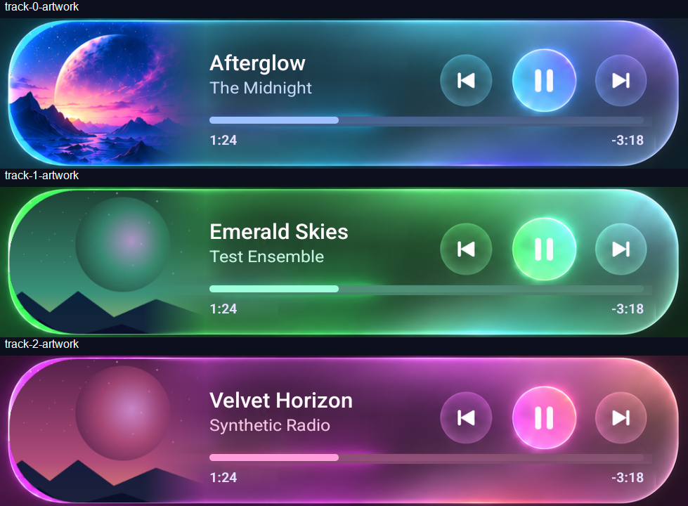

# Music Widget

**Your music. Your artwork. Your home screen.**

A glass-style Android widget that brings album art, playback controls, and live track progress to your home screen. Its colors follow your music, and your player stays a tap away.

[Get started](#get-started) · [How it works](#made-for-everyday-listening) · [For developers](#for-developers)

*Actual emulator captures of the full glass layout, using demo tracks and test artwork.*

## A different look for every track

**Artwork glass** picks up colors from the cover and carries them through the glass, highlights, artist text, and progress accent. The artwork itself keeps its original colors.

Prefer a consistent look? Choose **Classic glass** for the blue-purple finish. When artwork is missing, the widget falls back gracefully to Classic.

## Made for everyday listening

- **Control playback at a glance.** Play, pause, and skip tracks without opening your player. Controls follow the actions your media app supports.
- **Know where you are in the track.** Live elapsed time, remaining time, and progress stay in step with playback, including pause and resume.
- **Read the whole title.** Long titles in the full glass layout scroll once automatically, then settle back into place.
- **Get back to the music.** Tap the title, artist, or artwork to open the active player. Supported browser media destinations can return you to the playing tab.
- **Make it fit.** Resize the widget for a full artwork-led card or a compact layout with the essentials.
- **Keep a starting point ready.** When nothing is playing, **Open App** launches your chosen player or the last player you used. Choose a browser and you can also save a music website, such as `music.youtube.com`.

## Get started

1. Install an APK built from this repository. See the [build guide](MediaWidget/docs/DEVELOPMENT.md#build-and-install).
2. Open Music Widget and enable **Notification Access** using its setup action. This lets it discover active media sessions.
3. Add **Music Widget** from your launcher's widget picker, or use the app's add-widget action.
4. Start playback in a media app, then return to your home screen.

In setup, choose your preferred media app and switch between **Artwork glass** and **Classic glass**. **Open URL** appears only when the selected app is a browser; clear it to open that browser normally.

### What works where

Android 7.0+ is supported by the project. The full glass design, artwork-adaptive colors, and automatic title scroll are available in the full-width layout on Android 12+. Narrow widgets and older Android versions use simpler layouts.

Your media app supplies the track information and supported controls. Unknown-duration media hides progress, and the progress bar is a display rather than a seek slider. Browser tab restoration depends on the destination the browser exposes; real Chrome tab restoration is covered by emulator tests. Launcher spacing and resize behavior can vary.

## Local by design

Music Widget needs no account and has no Internet permission. Media information is processed on your device; player choices and optional browser URLs are saved locally. Your chosen player or browser handles streaming and its own network connection.

Background work follows playback: progress updates stop when the screen is off, playback is paused, or no widget is present. Artwork caches are bounded, and title animation runs in the launcher.

## For developers

The Android project lives in [`MediaWidget/`](MediaWidget/). Open that folder in Android Studio, or build with its Gradle wrapper.

| Reference | What you will find |
| --- | --- |
| [Development guide](MediaWidget/docs/DEVELOPMENT.md) | Build/install commands, architecture, rendering and navigation behavior |
| [Feature acceptance](MediaWidget/tools/FEATURE_ACCEPTANCE.md) | 117 functional emulator checks on the verified APK, manual evidence, and remaining coverage gaps |
| [Emulator regression suite](MediaWidget/tools/REGRESSION_COVERAGE.md) | Repeatable widget, real Chrome, lifecycle, color, and visual tests |
| [Performance and memory verification](MediaWidget/tools/NFR_VERIFICATION.md) | CPU samples, post-GC memory trends, resource counts, responsiveness, and test limits |
| [Debug player and emulator setup](MediaWidget/tools/EMULATOR_WIDGET_TESTS.md) | Deterministic media sessions and test commands |

Verification is scoped to the documented APK and emulator. Physical Samsung battery behavior, other launchers/API versions, and longer soak testing are not implied by those results.

## Contribute

Bug reports and improvements are welcome. For playback issues, include your Android version, launcher, media app, and steps to reproduce the behavior.

[MIT licensed](MediaWidget/LICENSE).
